

### Aprende mecanografía al ritmo de la música · Learn to type to the rhythm of music

<a href="https://www.ritmografia.com">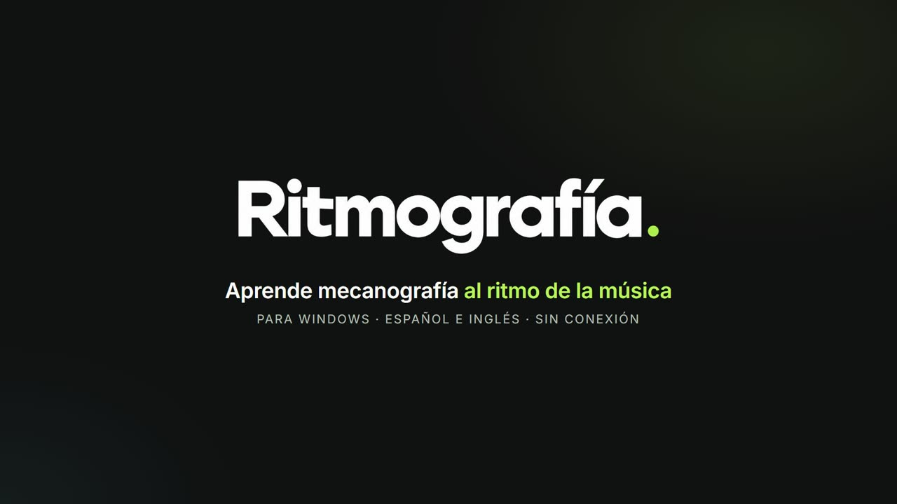</a>

**Español** · [English](#english)

---

## ✨ Qué es

**Ritmografía** es una app de escritorio para aprender a escribir sin mirar el teclado, con música libre de derechos sonando de fondo. Interfaz y práctica en **español e inglés**. Sin cuenta, sin conexión y sin anuncios: tus datos se quedan en tu equipo.

## 🎹 Funciones

| | |
|---|---|
| 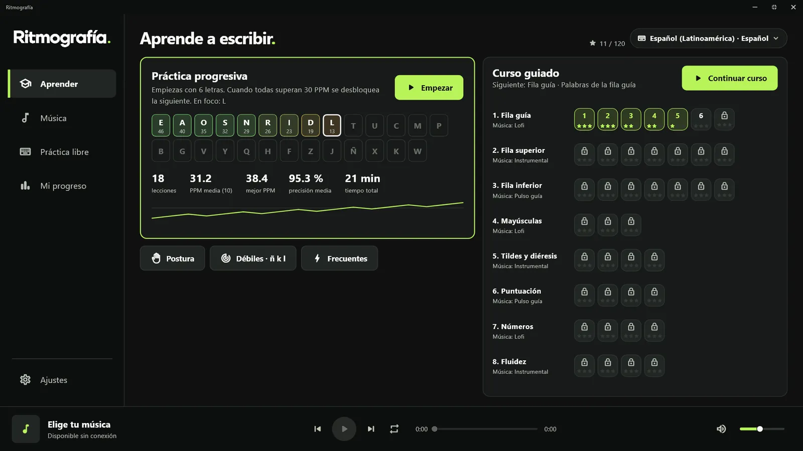 | **Curso guiado** — 8 unidades y más de 40 niveles, de la fila guía al teclado completo, con teclado en pantalla coloreado por dedo y manos guía. |
| 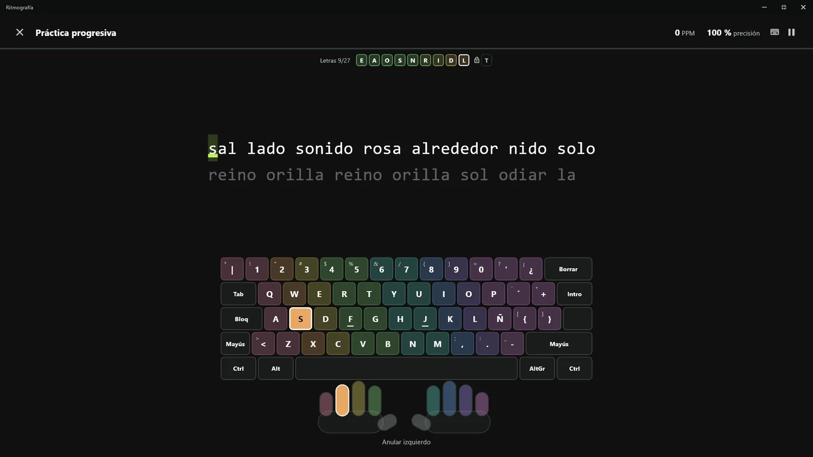 | **Práctica progresiva** — empieza con pocas letras y desbloquea nuevas cuando dominas las anteriores. |
| 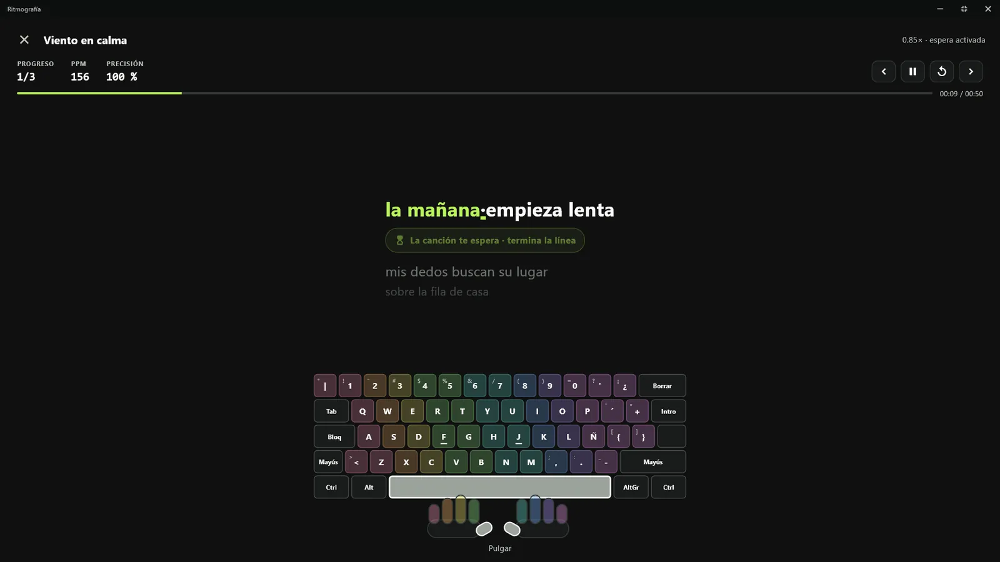 | **Escribe al compás** — escribe la letra de la canción mientras suena; si te quedas atrás, la canción te espera. |
| 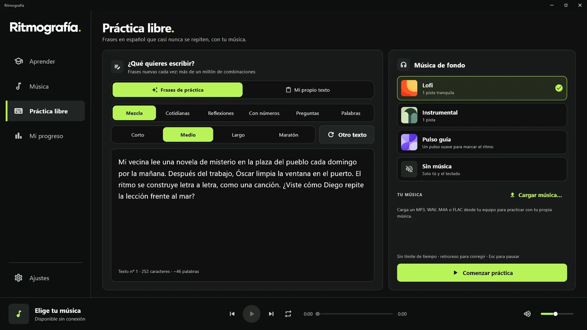 | **Práctica libre** — millones de frases distintas por idioma, sin repeticiones. |
| 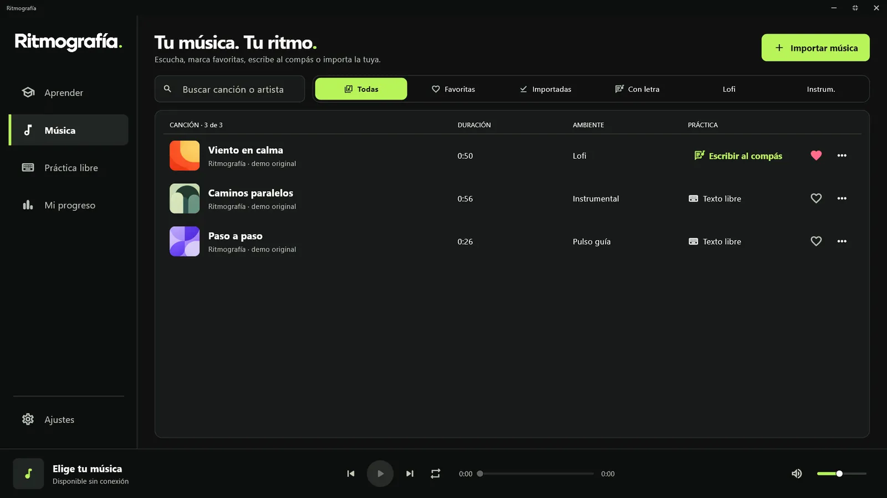 | **Tu música** — lofi e instrumental incluidos, favoritas, filtros e importación de tus canciones con letra y portada. |
| 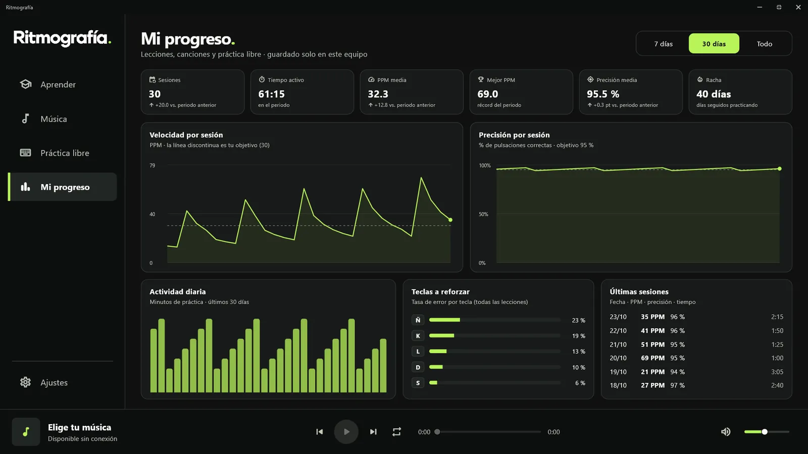 | **Mi progreso** — velocidad, precisión, racha, actividad y las teclas que debes reforzar. |
| 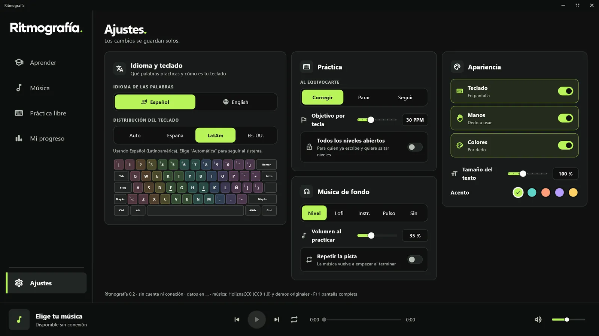 | **A tu medida** — idioma de la app, detección de la distribución (España, LatAm, EE. UU.), pantalla completa y un tutorial de bienvenida. |

## ⬇️ Instalación

**Windows 10/11 (64 bits)**
- Recomendado: **[Microsoft Store](https://apps.microsoft.com/detail/9PNQXWFT3RK5)** (sin avisos de SmartScreen y con actualizaciones automáticas).
- O el instalador directo:

1. Descarga **[Ritmografia-Setup-x64.exe](https://github.com/AndyCG03/ritmografia-releases/releases/latest/download/Ritmografia-Setup-x64.exe)** y ejecútalo (se instala para tu usuario, sin permisos de administrador).
2. Si SmartScreen avisa, pulsa **Más información → Ejecutar de todas formas** (el instalador aún no está firmado).

**Linux (64 bits)**
- Ubuntu, Debian y derivadas: descarga **[ritmografia_amd64.deb](https://github.com/AndyCG03/ritmografia-releases/releases/latest/download/ritmografia_amd64.deb)** y ejecuta `sudo apt install ./ritmografia_amd64.deb`.
- Otras distribuciones: descarga **[Ritmografia-linux-x64.tar.gz](https://github.com/AndyCG03/ritmografia-releases/releases/latest/download/Ritmografia-linux-x64.tar.gz)**, descomprímelo y ejecuta `./install.sh` (sin sudo). Necesita GTK 3 y GStreamer.

Novedades de cada versión en [Releases](https://github.com/AndyCG03/ritmografia-releases/releases) · Soporte: **info@ritmografia.com**

---

## 🇺🇸 English

**Ritmografía** is a desktop app that teaches you to type without looking at the keyboard while royalty-free lofi music plays. English and Spanish interface and practice. No account, no ads, works offline: your data stays on your computer.

| | |
|---|---|
| 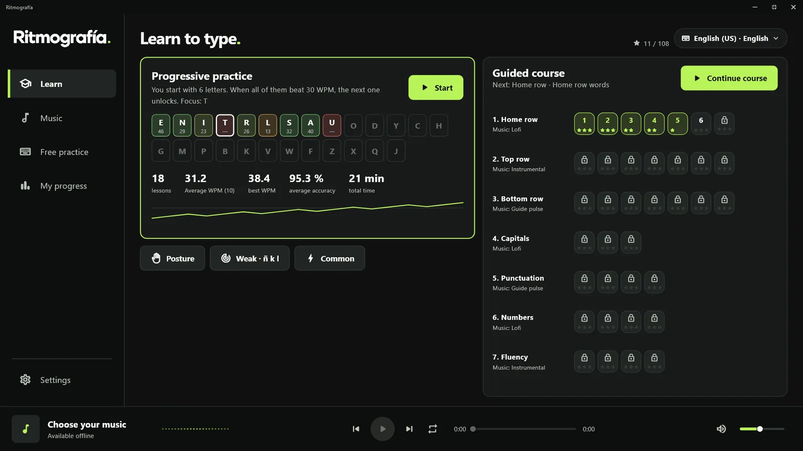 | **Guided course** — 8 units and 40+ levels, from the home row to full sentences, with an on-screen keyboard colored by finger and guide hands. |
| 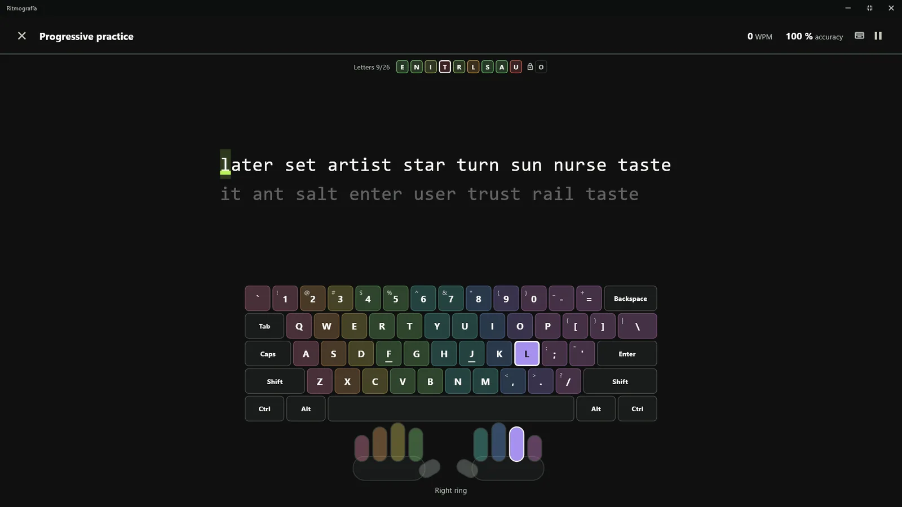 | **Progressive practice** — start with a few letters and unlock new ones as you master them. |
| 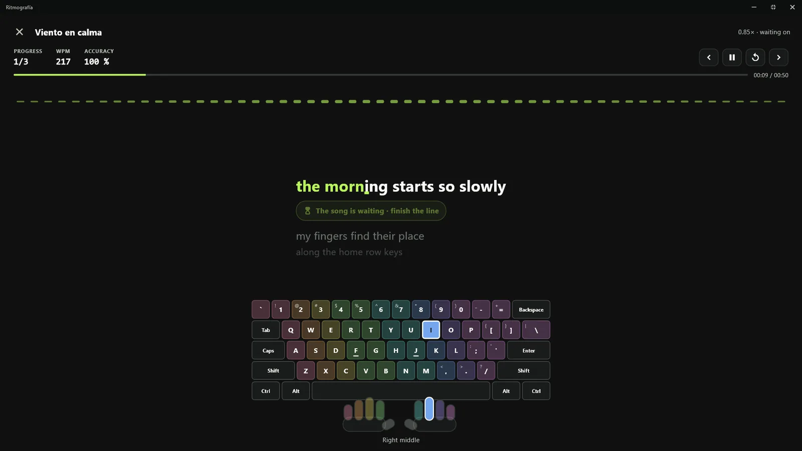 | **Type to the beat** — type a song's lyrics while it plays; fall behind and the song waits for you. |
| 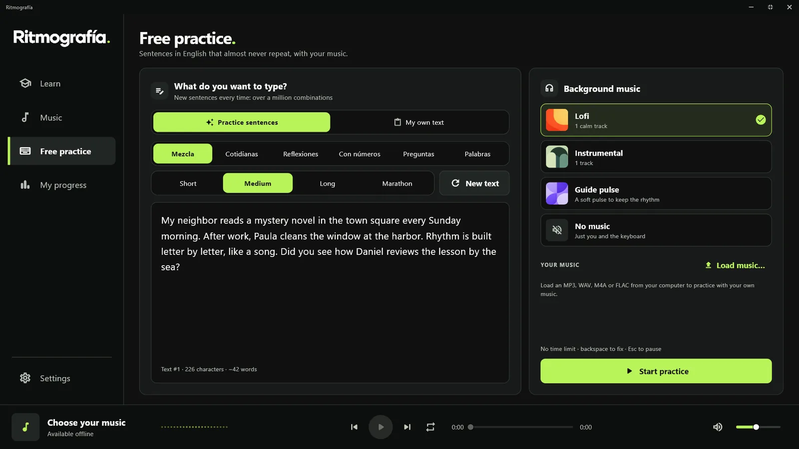 | **Free practice** — millions of sentences per language, never repeated. |
| 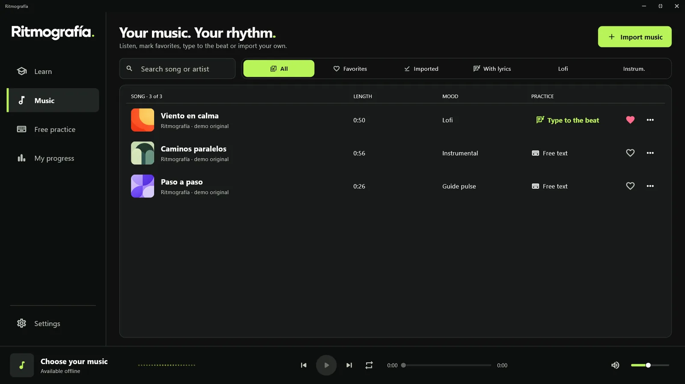 | **Your music** — lofi and instrumentals included, favorites, filters and importing your own songs with lyrics and cover art. |
|  | **My progress** — speed, accuracy, streak, activity and the keys to work on. |

**Install:** Windows → [Microsoft Store](https://apps.microsoft.com/detail/9PNQXWFT3RK5) or [Ritmografia-Setup-x64.exe](https://github.com/AndyCG03/ritmografia-releases/releases/latest/download/Ritmografia-Setup-x64.exe) · Linux → [.deb](https://github.com/AndyCG03/ritmografia-releases/releases/latest/download/ritmografia_amd64.deb) (`sudo apt install ./ritmografia_amd64.deb`) or [.tar.gz](https://github.com/AndyCG03/ritmografia-releases/releases/latest/download/Ritmografia-linux-x64.tar.gz) (`./install.sh`).

---

Desarrollada por **Ing. Andy Clemente** · Música: HoliznaCC0 (CC0) y Wikimedia Commons · [ritmografia.com](https://www.ritmografia.com)

